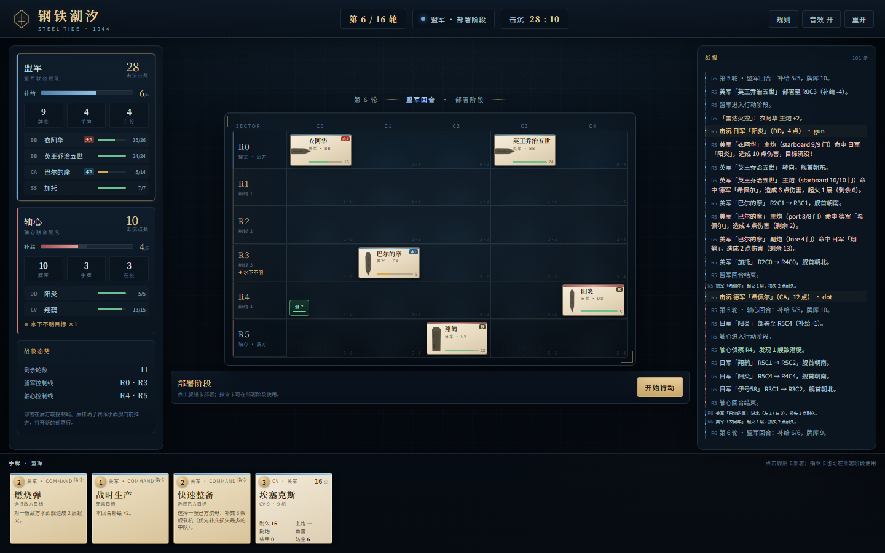

# 钢铁潮汐 · STEEL TIDE

二战海战卡牌对战网页版：6 × 5 战场、四向射界、主副炮、起火/进水、航母空袭、潜艇、自由牌组，以及手机 / PWA 适配。



## 这个文件夹是什么

这是一个**可以直接放到 GitHub Pages 的静态站点根目录**，不需要构建、不需要 Node/Python。

- `index.html`：完整站点入口（PWA，支持安装到主屏、离线缓存）
- `steel-tide.html`：单文件网页版（CSS/JS 全内联，258 KB；可以直接发给朋友）
- `css/`、`js/`：完整站点资源
- `manifest.json`、`sw.js`、图标：PWA
- `.nojekyll`：告诉 GitHub Pages 不要用 Jekyll 处理

## 部署到 GitHub Pages

1. 在 GitHub 新建一个 **public** 仓库，例如 `steel-tide`。
2. 把**本文件夹里的所有内容**上传到仓库根目录（不是把外层文件夹整个传上去）。
   - 网页上传：仓库页 → Add file → Upload files → 拖入这些文件和 `css/`、`js/` → Commit。
   - 或用 GitHub Desktop / git 推送。
3. 仓库 → **Settings → Pages**：
   - **Source** 选 **Deploy from a branch**
   - **Branch** 选 `main`（或 `master`），目录选 **`/ (root)`**
   - 点 **Save**
4. 等 1–2 分钟，访问：
   - 仓库名是 `steel-tide`：`https://<你的用户名>.github.io/steel-tide/`
   - 仓库名是 `<你的用户名>.github.io`：`https://<你的用户名>.github.io/`

HTTPS 生效后，安卓 Chrome / 桌面 Chrome 会出现「安装」；iOS Safari 用「分享 → 添加到主屏幕」。首次在线加载后，断网也能从缓存启动。

> 注意：仓库必须是 public（免费账号的 Pages 要求）；私有仓库需要相应套餐。不要把外层 `钢铁潮汐-GitHub-Pages` 文件夹名一起上传，`index.html` 必须在仓库根目录。

## 最快分享

不想建站，直接发 `steel-tide.html` 给朋友，双击就能玩；或者把这个文件拖进 Netlify Drop，也能马上得到一个公网链接。

## 本地预览

在这个目录运行：

```bash
python -m http.server 8123
```

打开 `http://127.0.0.1:8123/`。

## 规则与操作

完整规则、牌组限制、指令费用、潜艇上限和操作说明见游戏内「规则」按钮，或主项目的 `README.md`。

## 说明

这是基于讨论规则的独立实现，舰船数值为游戏平衡服务，不代表严格历史数据。全部界面、剪影与音效均为本地生成，无外部素材依赖。
